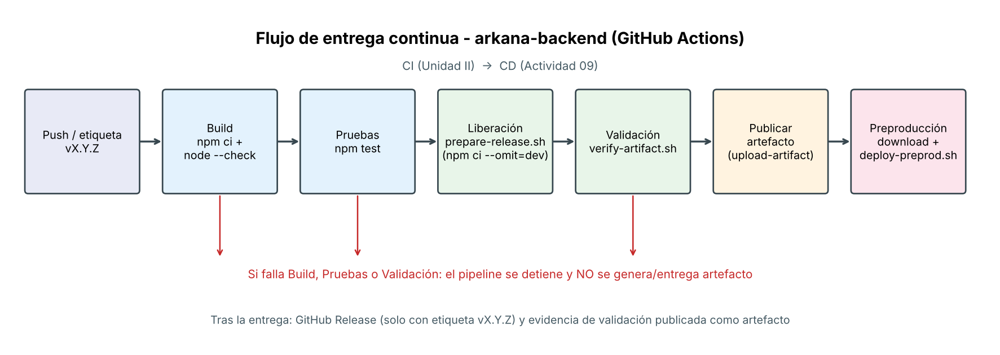
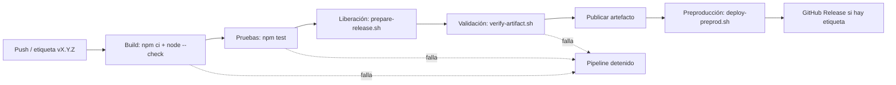

# Parte 1. Diseño del proceso de liberación

**Alumno:** [NOMBRE COMPLETO] · **Matrícula:** [MATRÍCULA] · **Grupo:** [GRUPO] · **Materia:** [MATERIA]
**Repositorio:** arkana-backend · **Rama:** `ci/actividad09-RNDaniela`

> **Adaptación al stack:** la actividad se plantea para Laravel/PHP, pero arkana-backend es un monorepo **Node.js 22** (microservicios `api-gateway` y `auth-service`, workspaces de npm, PostgreSQL). Se aplica el mismo proceso con las herramientas equivalentes: Composer → npm, PHPUnit → `node:test`, `storage/` y `bootstrap/cache/` → `logs/` del servicio.

## 1. Pasos para preparar una versión liberable
1. Obtener el código (`actions/checkout`).
2. Instalar dependencias con `npm ci` y verificar sintaxis.
3. Ejecutar pruebas automatizadas (`npm test`).
4. Determinar la versión (SemVer).
5. Armar el paquete con lista blanca de archivos y `npm ci --omit=dev` (`scripts/prepare-release.sh`).
6. Validar el paquete (`scripts/verify-artifact.sh`).
7. Publicar el artefacto de la ejecución (`actions/upload-artifact@v4`).
8. Descargarlo, validarlo de nuevo e instalarlo en preproducción (`scripts/deploy-preprod.sh`).

## 2. Archivos y dependencias necesarios en otro entorno
| Incluido | Motivo |
|---|---|
| `services/*/src` y `services/*/package.json` | Código de los microservicios |
| `package.json`, `package-lock.json` | Workspaces y versiones exactas |
| `node_modules` (solo producción) | Dependencias ya instaladas con `--omit=dev` |
| `init-db.sql` | Estructura inicial de la base de datos |
| `.env.example` | Plantilla de variables (sin valores reales) |
| `scripts/deploy-preprod.sh`, `scripts/verify-artifact.sh` | Instalación y validación en destino |
| `VERSION.txt` | Versión, commit, fecha y ejecución |

**Excluidos:** `.env` y cualquier `.env.*` real, `*.pem`/`*.key`, `.git`, `.github`, `tests/`, `docker-compose.yml` (es de desarrollo y trae credenciales de ejemplo), logs.

## 3. Estrategia de versiones (SemVer `vMAJOR.MINOR.PATCH`)
- `v1.0.1` → corrección de errores (PATCH). `v1.1.0` → funcionalidad compatible (MINOR). `v2.0.0` → cambio incompatible (MAJOR).
- **Versión oficial:** se crea una etiqueta `vX.Y.Z` que debe coincidir con `version` de `package.json`. Genera además un GitHub Release.
- **Candidata (rc):** cualquier push a `main`, `develop` o a la rama de la actividad genera `X.Y.Z-rc.<n° de ejecución>` (ej. `1.0.0-rc.12`), solo como artefacto.

```bash
npm version minor --no-git-tag-version   # actualiza package.json
git commit -am "chore: versión 1.1.0" && git tag v1.1.0 && git push origin v1.1.0
```

## 4. Criterios para generar un artefacto
- Build y pruebas en verde (la etapa de liberación depende de ellas).
- Etiqueta con formato SemVer y coincidente con `package.json`.
- Existe `package-lock.json` (instalación reproducible).
- El paquete contiene todos los archivos requeridos y **no** contiene `.env`, llaves ni tokens.
- Las dependencias de producción se resuelven y todo el JavaScript pasa `node --check`.
- Checksum SHA-256 generado y verificado.

## 5. Diagrama del flujo



